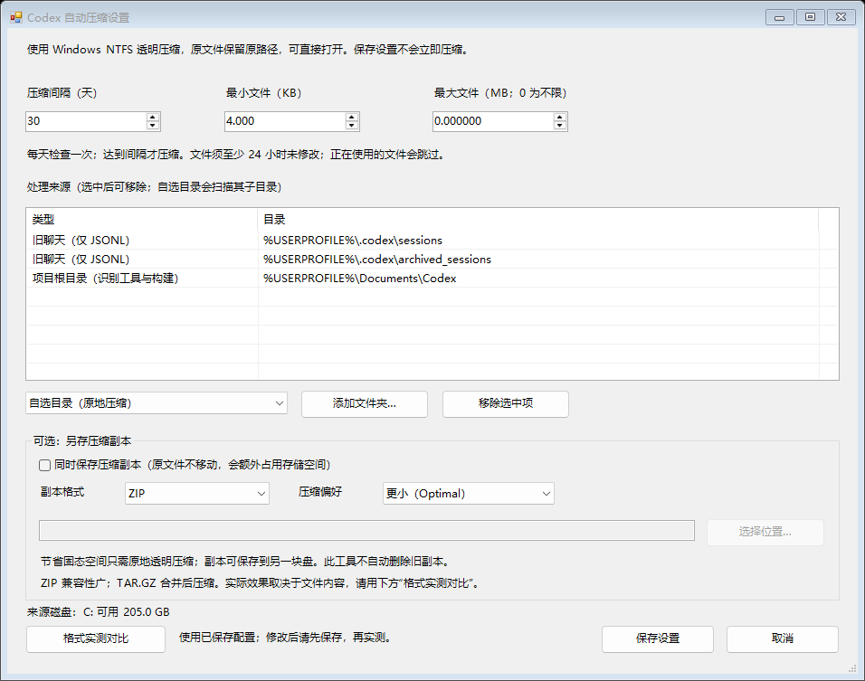
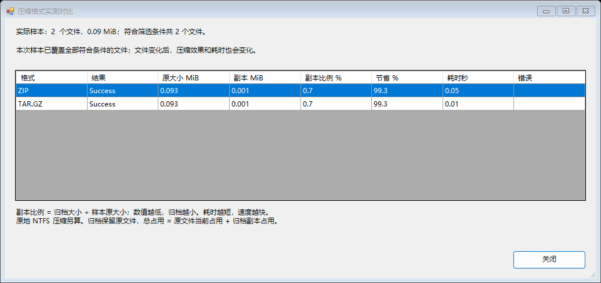

# Codex Auto Compact

[简体中文](README.md) | [English](README.en.md)

[](https://github.com/979823474/codex-auto-compact/actions/workflows/windows.yml)
[](https://codeload.github.com/979823474/codex-auto-compact/zip/refs/heads/main)
[](LICENSE)

A local Windows compression tool and Codex skill plugin that helps reduce disk usage while keeping files at their original paths. Customize the interval, file size limits, and source folders, then let Windows Task Scheduler check when compression is due.

The tool runs offline, needs no API key, and does not use recurring AI calls. This is an independent community project with no affiliation with OpenAI.

**[Download for Windows (ZIP)](https://codeload.github.com/979823474/codex-auto-compact/zip/refs/heads/main)** · [v0.1.0 feature notes](docs/releases/v0.1.0.md) · [Report an issue](https://github.com/979823474/codex-auto-compact/issues)

The download is the main branch source ZIP with ready-to-run scripts. Extract the entire archive; no build step is required. Release assets have not been published yet, and this ZIP changes when main is updated.

## Screenshots and sample results

Choose the interval, file size limits, source folders, and optional archive destination in the settings window. The current interface is in Simplified Chinese:



One local comparison used **64 files totaling 15,909,531 bytes (15.17 MiB), with the Optimal level**:

| Archive format | Resulting size | Percentage of original | Saved | Single-run time |
| --- | --- | --- | --- | --- |
| ZIP | 3,600,105 bytes (3.43 MiB) | 22.63% | 77.37% | 0.464 s |
| TAR.GZ | 3,575,739 bytes (3.41 MiB) | 22.48% | 77.52% | 0.420 s |

These results apply only to that sample, not to other files or an entire library. The table measures **additional archive copies**: originals are retained, so the destination uses this extra space. NTFS transparent compression is the feature that reduces space on the source volume.

<details>
<summary>View the format comparison window</summary>



This screenshot uses a different demonstration sample of only 2 small files, about 0.09 MiB. Its 99.3% figure is not the result in the table above and does not represent an entire library.

</details>

## Requirements

- Windows 10 or 11 with NTFS source volumes.
- Windows PowerShell 5.1, included with Windows, or a compatible PowerShell environment.
- Read and write access to the selected local files under the current Windows account.

This tool handles local Windows files. It cannot compress the cloud Library in ChatGPT. Installing the plugin does not give a cloud-only chat access to your computer.

## Quick start

1. [Download the Windows ZIP](https://codeload.github.com/979823474/codex-auto-compact/zip/refs/heads/main), extract the entire archive, and open its **codex-auto-compact-main** folder. No build step is required.
2. Double-click **打开工具.cmd** to open the tool. Choose menu **7** for settings: interval, file size range, source folders, and optional archive copies.
3. Choose **8** to preview the files that match your settings.
4. Choose **3** to compress now, or run **安装自动压缩.cmd** to install the automatic task.

The current interface is in Simplified Chinese. These are the main menu options:

| Option | Action |
| --- | --- |
| 1 | Show status and the next due time |
| 2 | Install or update the automatic task |
| 3 | Compress now |
| 4 / 5 | Pause / resume the automatic task |
| 6 | Remove the automatic task |
| 7 | Open settings |
| 8 | Preview matching files |
| 9 | Compare archive formats using saved settings |

The default installation directory is `%LOCALAPPDATA%\CodexAutoCompact`. Reinstalling preserves existing settings. No administrator account or saved Windows password is required.

For installation in another folder, open Windows PowerShell in the extracted project folder:

```powershell
.\Manage.ps1 -Action Install -InstallDirectory 'C:\Tools\CodexAutoCompact'
.\Manage.ps1 -Action Status
.\Manage.ps1 -Action Settings
.\Manage.ps1 -Action Scan
.\Manage.ps1 -Action Compare
```

## Settings

| Setting | Purpose | Default |
| --- | --- | --- |
| Interval | Time between successful compression runs | 30 days; configurable from 1 to 3650 days |
| Minimum file size | Skip smaller files | 4 KiB |
| Maximum file size | Skip larger files; 0 means unlimited | Unlimited |
| Minimum file age | Skip recently modified files | 24 hours |
| Source folders | Select local files to process | Known Codex session and development cache locations |
| Archive destination | Optional folder for additional archive copies | Disabled |
| Archive format | ZIP or TAR.GZ | ZIP |
| Archive level | Fastest or Optimal | Optimal |

File size limits apply to the original logical file length. They do not specify a target archive size or guarantee a compression ratio.

The archive destination must be outside every selected source folder. Save settings before running a format comparison; unsaved changes are not included.

## How compression works

The main feature uses standard Windows NTFS transparent compression through `compact.exe /C`. Windows decompresses data when a program reads it. File paths, extensions, and contents stay the same, so local programs and GPT/Codex tools with local file access can continue reading those paths.

Optional ZIP and TAR.GZ copies are separate backups. The originals remain in place, so these copies consume additional space on the destination drive. Choosing an archive format or level only affects those copies; NTFS compression continues to use the Windows standard method.

| Method | Reading and typical use | Disk space behavior |
| --- | --- | --- |
| NTFS transparent compression | Programs read the original paths normally | Reduces allocated space on the source volume when data is compressible |
| ZIP copy | Widely supported; files are compressed individually | Adds a separate archive while retaining the originals |
| TAR.GZ copy | Compresses a combined stream; similar text may compress better, but results vary | Adds a separate archive; extracting an individual file requires archive processing |

TAR.GZ stores names in UTF-8 pax headers. Some Windows `tar.exe` builds cannot extract non-ASCII names in certain system locales. Use a UTF-8-aware extractor or choose ZIP if this occurs.

Text often compresses well. Images, video, and existing archives usually offer less saving. The tool reports actual space changes instead of promising a fixed percentage.

### Compare formats on your files

The comparison feature tests ZIP and TAR.GZ on the same saved selection, limited to **64 files and 32 MiB**. It reports:

- Original sample size and resulting archive size.
- Archive size as a percentage of the original and the percentage saved.
- Elapsed compression time for each format.

Temporary sample archives are removed afterward. Source files and the last successful compression time are unchanged. An error is reported for the affected format rather than silently substituting another one.

Archive size is the byte length of the archive file, excluding filesystem allocation and metadata. A sample cannot predict the result for the entire library, and a single timing measurement can be affected by caching and system load. The tool does not guarantee that GPT can read arbitrary files directly inside an archive.

## Scheduling and file selection

The installed task checks daily at **20:00** and **one minute after sign-in**. It processes files only when the configured interval has passed since the last successful run. Changing the interval does not require reinstalling the task.

The task runs under the current user's normal permissions while that user is signed in. It does not wake the computer. When the computer is off or the user is signed out, a later sign-in provides another due check. No background process needs to stay running.

The tool skips databases, credentials, lock files, reparse points, recently modified files, and files it cannot safely access. Already compressed files are skipped for NTFS compression, but may still be included in an enabled archive copy if they match the other filters. Preview the selection before the first run.

Avoid selecting an entire system drive, a browser profile, or the entire `.codex` directory. Logs stay on the computer; the tool does not upload file contents. It does not delete or move original files, and it does not automatically remove old archive copies.

Removing the scheduled task leaves files, archives, logs, and existing NTFS compression in place. To turn off compression for selected files, open **Properties → Advanced** in File Explorer and clear **Compress contents to save disk space**. Decompression requires sufficient free disk space.

## Use as a Codex plugin

The repository includes `plugin.json`, a `skills/` directory, and `.agents/plugins/marketplace.json`. It is a local skill plugin with scripts; no MCP server is required.

In a Codex client that supports local plugins, add the extracted project as a marketplace:

```powershell
codex plugin marketplace add "C:\path\to\codex-auto-compact"
```

Select **Codex Auto Compact** in the client's plugin list and install it. Clients with the corresponding CLI support can also use:

```powershell
codex plugin add codex-auto-compact@codex-auto-compact-marketplace
```

Start a new chat to verify that the skill loads. Example requests:

> Use codex-auto-compact to show my settings and the next compression due time.

> Change the interval to 15 days and process only files between 1 MiB and 200 MiB.

> Compare ZIP and TAR.GZ using my current filters, then help me choose an archive destination.

Plugin availability depends on the client version and local execution permissions. A manifest or an installed standalone tool does not prove that the skill loaded. Adding the marketplace does not install the Windows scheduled task. Publishing this repository also does not automatically list the plugin in a public OpenAI directory.

Official reference: [Plugin packaging and local distribution](https://developers.openai.com/plugins/build/plugins).

## Development and verification

Run the checks from the repository root using Windows PowerShell 5.1:

```powershell
powershell.exe -NoProfile -ExecutionPolicy Bypass -File .\tests\Validate-Package.ps1
powershell.exe -NoProfile -ExecutionPolicy Bypass -File .\tests\Integration.ps1
powershell.exe -NoProfile -ExecutionPolicy Bypass -File .\tests\ArchiveFormats.ps1
powershell.exe -NoProfile -ExecutionPolicy Bypass -File .\tests\FormatComparison.ps1
```

The Windows GitHub Actions workflow parses the PowerShell sources and runs the tests. Tests cover compression behavior, content hashes, filtering, scheduling, locking, archive formats, and sample comparison in temporary folders. CI uses Python 3.13's standard `tarfile` module as an independent UTF-8-aware extractor (`ArchiveFormats.ps1 -TarExtractor Python`); local tests use Windows `tar.exe` by default. Python is a CI/test dependency only; the tool itself does not require Python. Passing CI does not mean a scheduled task has been installed or run on an end user's computer.

Keep `Archive.ps1` with the rest of the tool: it provides the archive and comparison engine. Public source should contain generic defaults only. Do not commit personal paths, session contents, credentials, logs, `state.json`, installation records, or backup archives.

## License

[MIT](LICENSE).
